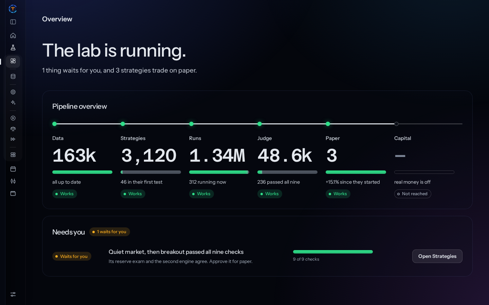
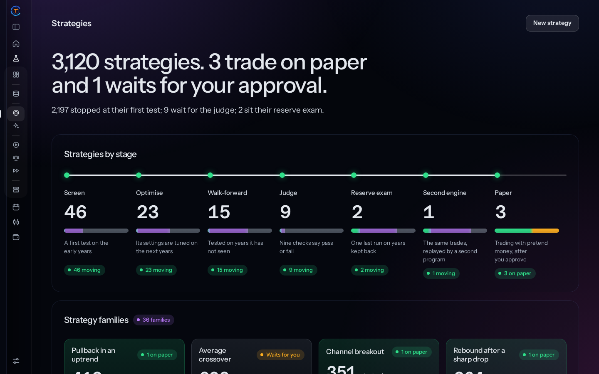
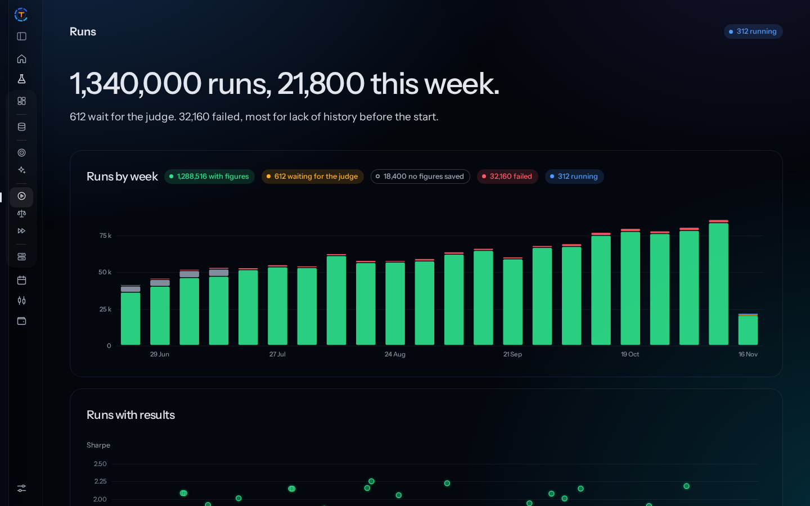
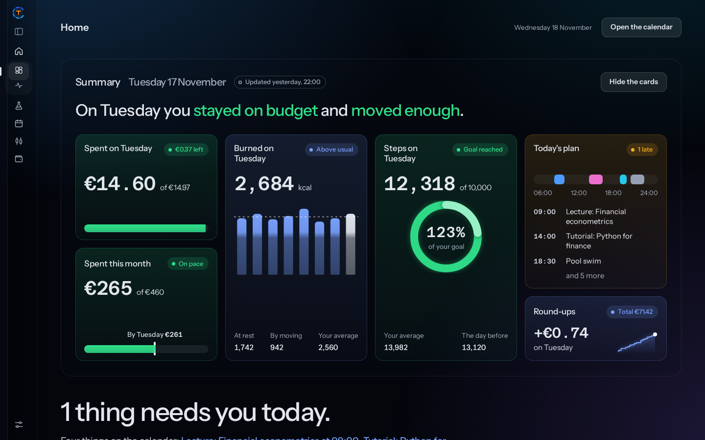
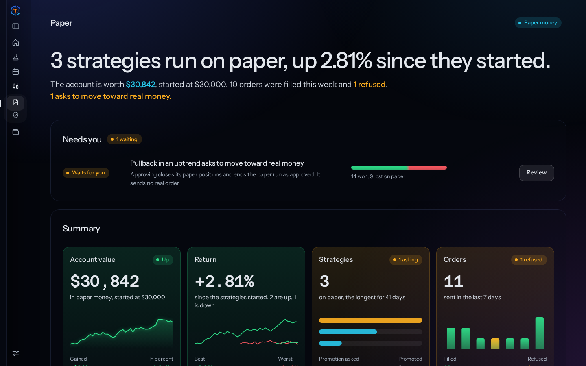
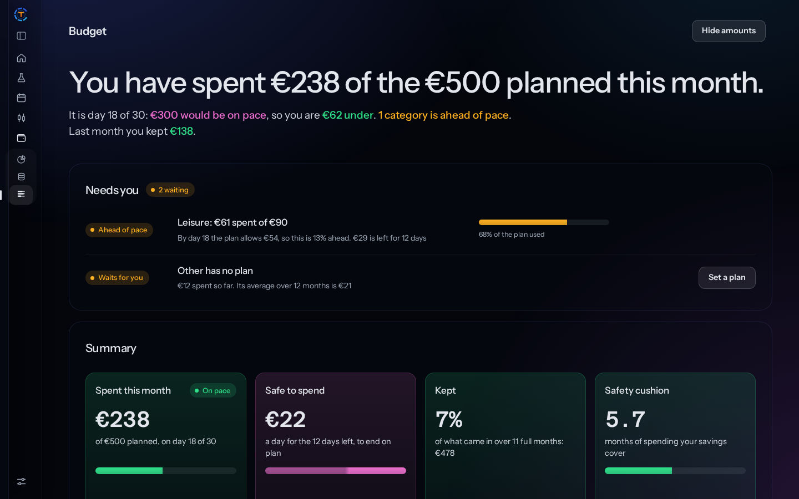

# Dashboard showcase

A personal research lab for trading strategies and the dashboard that runs it, with the rest of my day in the same place.

The lab writes strategy ideas from templates, backtests them on decades of prices, grades every result with nine statistical checks, retests the survivors in a second engine and sends the few that pass to paper trading. Real money stays off behind a kill switch, limits enforced on the server and my written approval.

The screenshots show the interface design with example data.



## What the dashboard does

| Page | What you can see and do |
|---|---|
| Overview | Where the pipeline stands, from data to paper trading, and what is waiting for a decision. |
| Strategies | Every strategy, the stage it reached, the family it comes from and its results. |
| Runs | Every backtest, week by week, with the failures and their reasons. |
| Judge | The nine checks every result must pass, how many runs passed each one, and the full grading of any run. |
| Generator | Templates, theories and searches. A grid shows every strategy on its way through screen, optimise, choose, replay, walk forward and judge. Start a theory, pause a search, or walk one strategy through every step. |
| Data library | Market prices, stock lists and company events. |
| Datasets | Every dataset by kind with its rows, size and newest price. Daily prices back to 1962, hourly, five minute and one minute bars, futures and dollar bars. |
| Fundamentals | Company figures from SEC filings, shown as they were known on any past date, so a backtest only sees what was public at the time. Companies side by side. |
| Strategy editor | Each strategy is plain Python with its settings, written and checked in the page. |
| Operations | The health of every part, from the backtest worker to the paper broker. |
| Home | The day at a glance. Spending, training, sleep, the calendar and the markets. |
| Calendar | Events, to-dos, the weather and where the week's time goes. |
| Paper trading | The strategies trading with pretend money, their orders and the limits they run under. |
| Positions | What I hold, what I put in and what it is worth now. |
| Money | Net worth across accounts, month by month. |
| Budget | Spending against the monthly plan, category by category. |

## Data

Every dataset the lab holds, by kind.


## The nine checks

Every finished backtest is graded before it can move on.

1. Is there enough evidence? Trade count, degrees of freedom and fat tails.
2. Does it hold out of sample? Walk forward tests on years the search never saw.
3. How many trials were made? The result is judged against the number of settings tried.
4. Do nearby settings do as well? A good result should sit on a plateau, not a spike.
5. How likely is it overfitted? Combinatorially symmetric cross validation.
6. Is it inside Monte Carlo bounds?
7. Does it survive a permutation test? The same rules on shuffled prices should do worse.
8. Does it still make money without its best winning streak?
9. Does it beat random entries and buy and hold?

The checks follow published methods from Pardo, Masters, Aronson, López de Prado and Taleb.

## How it is built

1. Data. Prices from EODHD and Alpaca, company filings from SEC EDGAR, news from Alpaca and Benzinga.
2. Generator. Templates with open slots become theories, and each theory is searched over its settings.
3. Backtest. A Docker worker runs each strategy with VectorBT Pro.
4. Judge. The nine checks above.
5. Retest. Survivors run again in NautilusTrader and the two engines' results are compared.
6. Paper trading. Approved strategies trade on an Alpaca paper account.
7. Real money. Off, behind the kill switch and the server limits.

The research side and the server are written in Python, the server with FastAPI and SQLite. The interface is React and TypeScript with Vite, TanStack Query, Recharts and Tailwind.

## How the code is organised

```
research_lab/
  generator/        turns a theory file into strategy code
  theories/         the theory templates and the range of every setting
  theory_search/    the search over a theory's settings
  theory_stage/     the optimise and walk forward steps
  theory_run/       runs one strategy over its whole stock list
  strategies/       the strategies and their shared base
  indicators/       the indicator library
  exits/            exit rules
  worker/           the backtest worker
  docker/           the worker images, VectorBT Pro and NautilusTrader
  fetcher/          the price fetcher
  synthetic/        made-up stocks with planted signals, to test the pipeline end to end
  judge_arms/       the price based parts of the judge
  nautilus_drift/   the gap between the backtest and NautilusTrader
dashboard/
  backend/          the FastAPI server: routes, the nine checks, paper trading, data stores, connections
  frontend/         the React interface
docs/images/        the screenshots
```

## Screenshots

### Research

| | |
|---|---|
|  |  |
|  |  |
|  |  |
|  | |

### Daily life

| | |
|---|---|
|  |  |

### Portfolio

| | |
|---|---|
|  |  |
|  |  |
