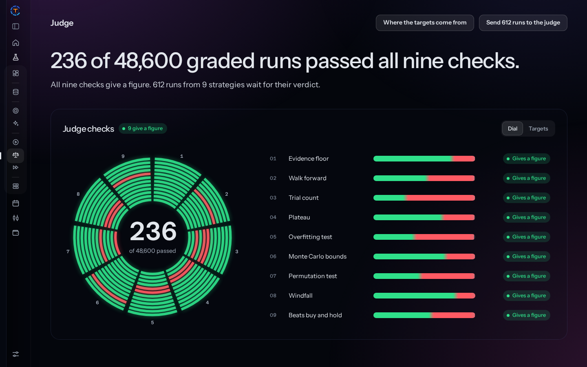
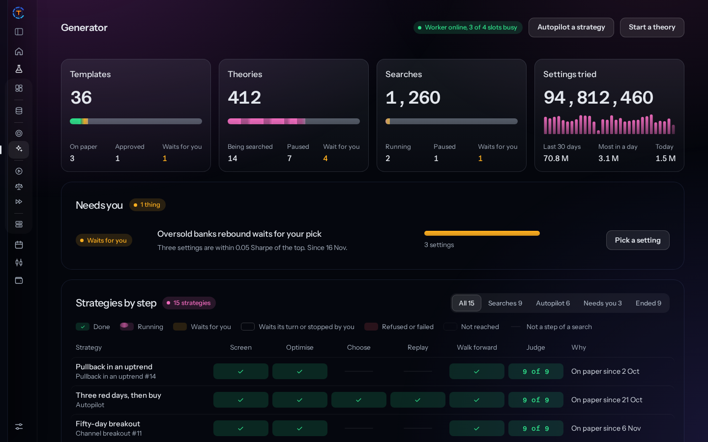
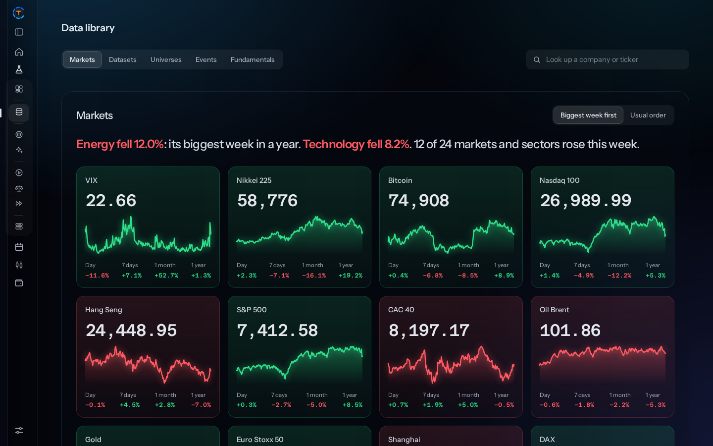
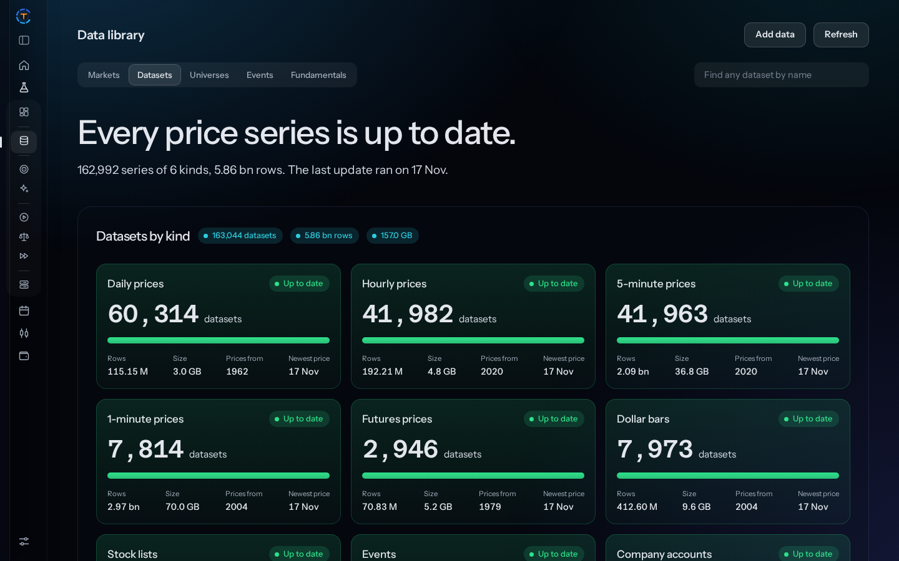
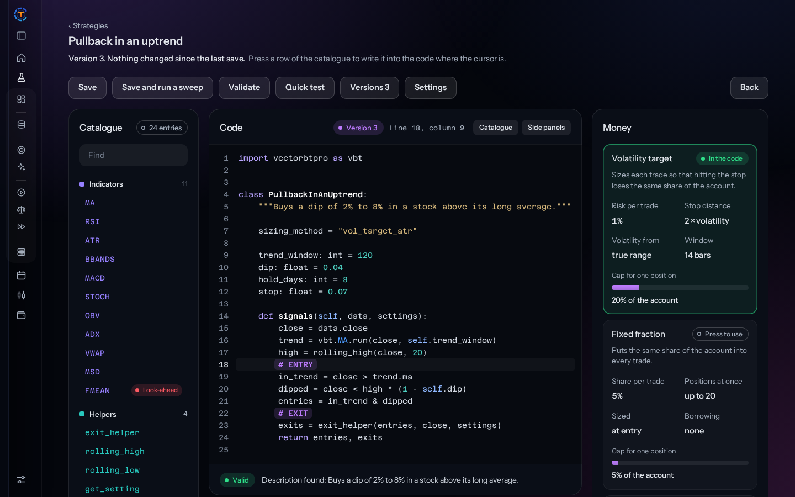
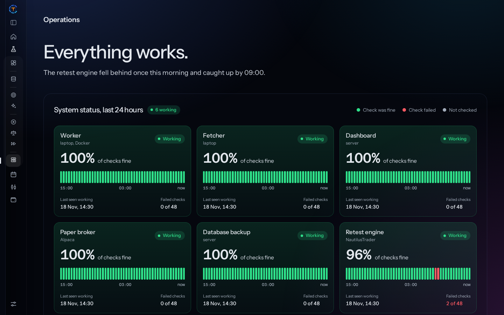
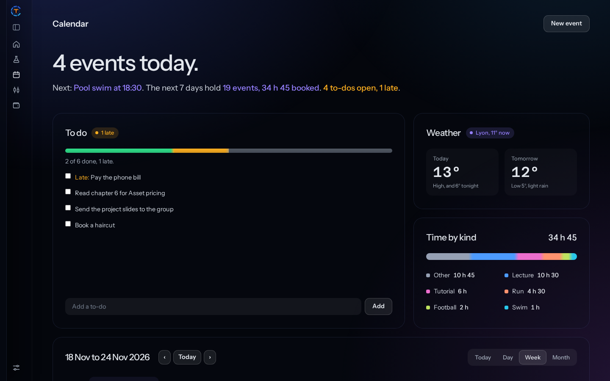
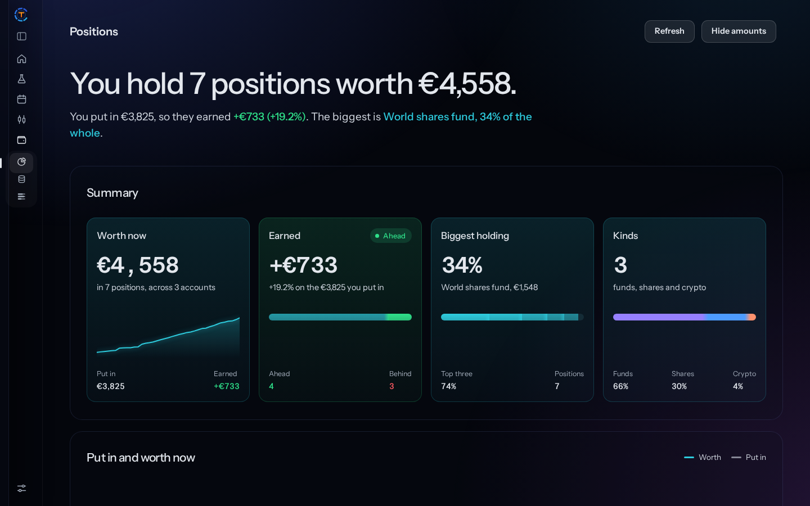
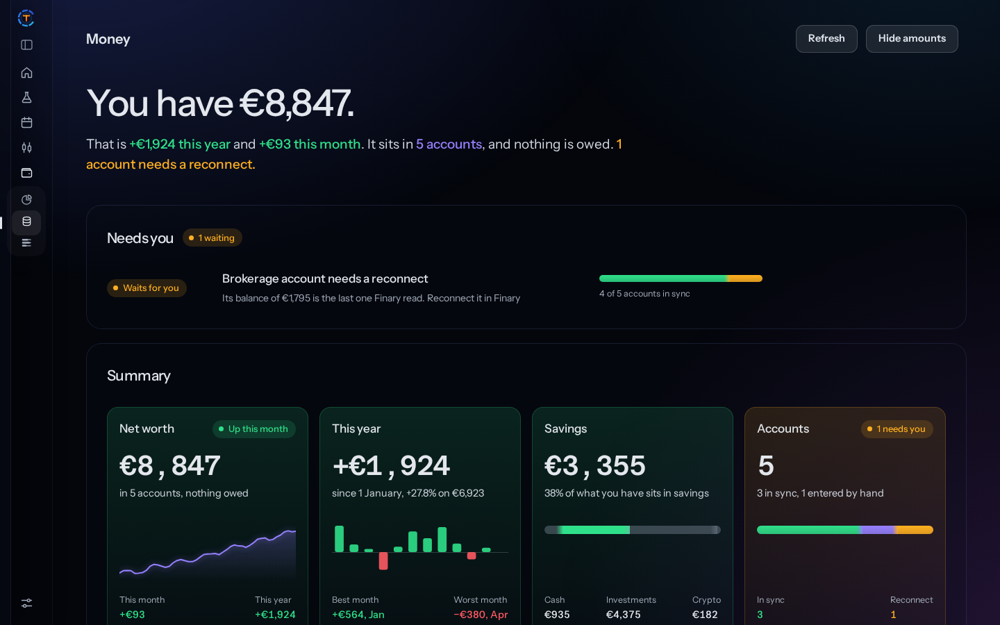

# Dashboard showcase

A personal research lab for trading strategies, with one dashboard that runs the whole process and the rest of my day.

The lab writes strategy ideas from templates, tests them on decades of price history, grades every result with nine statistical checks, retests the survivors in a second engine and sends the few that pass to paper trading. Nothing reaches real money without a kill switch, limits enforced on the server and my written approval.

The pictures show the interface design with example data. The figures in them are illustrative.

## Research

### Overview

Where the pipeline stands, from data to paper trading, and what is waiting for me.

### Strategies

Every strategy, the stage it reached and the family it comes from.

### Runs

Every backtest the lab ran, week by week, with the failures and their reasons.

### Judge

Nine checks every result must pass before it can move on. They ask whether there is enough evidence once trades and fat tails are counted, whether the result holds out of sample in walk forward tests, how many trials were made, whether nearby settings do as well, how likely the result is overfitted, where it sits in Monte Carlo bounds, whether it survives a permutation test, whether it still makes money without its best winning streak, and whether it beats random entries and buy and hold. The checks follow published methods from Pardo, Masters, Aronson, López de Prado and Taleb.

### Generator

Templates become theories, theories become searches over settings, and the best settings become strategies. The grid shows every strategy on its way through the six steps.

### Data library

Daily prices for US stocks and funds back to 1962, hourly, five minute and one minute bars, futures, company filings from the SEC and news headlines.

### Strategy editor

Each strategy is plain Python with its settings, written and checked in the page.

### Operations

The health of every part of the system, from the worker to the paper broker.

## Daily life

### Home

The day at a glance. Spending, training, sleep, the calendar and the markets.

### Calendar

Events, to-dos, the weather and where the week's time goes.

## Portfolio

### Paper trading

The strategies trading with pretend money, their orders and the limits they run under.

### Positions

What I hold, what I put in and what it is worth now.

### Money

Net worth across accounts, month by month.

### Budget

Spending against the monthly plan, category by category.

## How it is built

1. Data. Prices come from EODHD and Alpaca, company filings from SEC EDGAR, news from Alpaca and Benzinga.
2. Generator. Templates with open slots become theories, and each theory is searched over its settings.
3. Backtest. A Docker worker runs each strategy with VectorBT Pro.
4. Judge. The nine checks grade every finished run.
5. Retest. Survivors run again in NautilusTrader and the two engines' results are compared.
6. Paper trading. Approved strategies trade on an Alpaca paper account.
7. Real money stays off behind the kill switch and the server limits.

### Code

`research_lab` holds the research side in Python. The generator and theory search, the strategies, the backtest worker and its Docker images, the price fetcher, synthetic test data and the NautilusTrader retest.

`dashboard/backend` is the server, written in Python with FastAPI and SQLite. It holds the routes behind every page, the nine judge checks, paper trading through Alpaca, the store for events and company filings, and the connections to Garmin, Google Calendar, Gmail and the weather.

`dashboard/frontend` is the interface, written in React and TypeScript with Vite, TanStack Query, Recharts and Tailwind.
